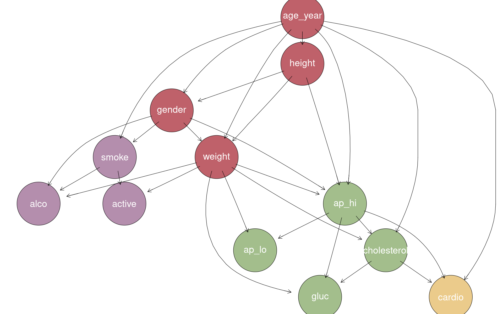
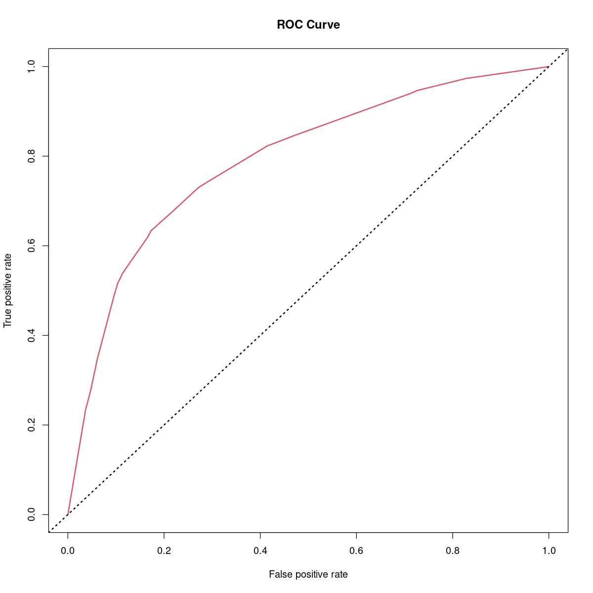
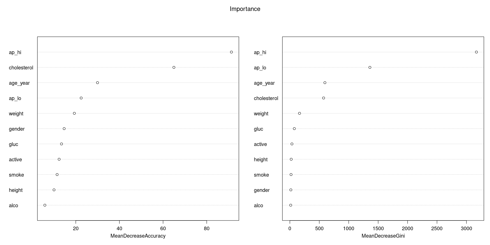

# Cardiovascular Disease Prediction via Bayesian Networks & Machine Learning

[](https://www.r-project.org/)
[](https://opensource.org/licenses/MIT)
[](#)

> **Academic Project** developed for the *Advanced Statistics for Physics Analysis* course.  
> **Authors**: Chiara Maccani, Francesco Zambelli, Pietro Miglioranza.

---

## 📌 Overview

Cardiovascular diseases (CVDs) are the leading cause of death globally. Early diagnosis and identification of key risk factors are crucial for preventative clinical intervention.

This project investigates the [Kaggle Cardiovascular Disease Dataset](https://www.kaggle.com/sulianova/cardiovascular-disease-dataset) comprising **70,000 patient records** and 11 clinical features. The primary objective is to evaluate **Bayesian Networks (BN)** as transparent, interpretable probabilistic graphical models for disease classification, benchmarked against standard discriminative classifiers: **Decision Trees** and **Random Forests**.

<p align="center">
  
  <br>
  <em>Figure 1: Best Bayesian Network DAG structure learned via the K2 Algorithm and Block Permutations.</em>
</p>

### Key Highlights
- **Custom K2 Algorithm Implementation**: Implemented from scratch in R based on the Cooper & Herskovits (1992) score metric, extended to use log-likelihood/BIC scores to avoid floating-point underflow.
- **Block Permutations for Ordering**: Addressed the factorial variable-ordering search space ($11! \approx 39.9 \times 10^6$) using a domain-informed block permutation strategy.
- **Continuous vs. Discrete Modeling**: Evaluated DAG structure learning and prediction performance across both discretized (categorical) and continuous data formats.
- **Interpretability vs. Accuracy**: Demonstrated that while ensemble trees provide slightly higher classification accuracy, Bayesian Networks offer bidirectional probabilistic inference, causal explainability, and generative modeling.

---

## 📊 Dataset & Preprocessing

The dataset consists of 70,000 patients with the following clinical and lifestyle features:

| Feature | Type | Description |
| :--- | :--- | :--- |
| `age` | Continuous | Age of the patient (recorded in days, converted to years) |
| `gender` | Categorical | 1: Female, 2: Male |
| `height` / `weight` | Continuous | Measured in cm and kg (used to compute BMI) |
| `ap_hi` / `ap_lo` | Continuous | Systolic and diastolic blood pressure |
| `cholesterol` | Categorical | 1: Normal, 2: Above Normal, 3: Well Above Normal |
| `gluc` | Categorical | 1: Normal, 2: Above Normal, 3: Well Above Normal |
| `smoke` | Binary | Smoking habit |
| `alco` | Binary | Alcohol intake |
| `active` | Binary | Physical activity |
| `cardio` | Binary (Target) | Presence (1) or absence (0) of cardiovascular disease |

### Preprocessing Pipeline
1. **Anomaly Correction**: Identified and corrected recording errors and inverted signs in blood pressure (`ap_hi`, `ap_lo`) via `data_corr()` in [`src/preprocessing.R`](src/preprocessing.R).
2. **Feature Engineering**: Derived `age_year` and Body Mass Index (`BMI`).
3. **Discretization**: Binned continuous variables into clinically meaningful categories (e.g., blood pressure categories: Optimal, Normal, Grade 1–3 Hypertension; BMI categories: Underweight, Normal, Overweight, Obese).

---

## 🧠 Methodology

### 1. Bayesian Networks & Structure Learning
Bayesian Networks represent joint probability distributions via Directed Acyclic Graphs (DAGs) and Conditional Probability Tables (CPTs):

$$P(X_1, \dots, X_n) = \prod_{i=1}^n P(X_i \mid \text{Parents}(X_i))$$

We explored three network structures:
- **Expert / Hand-crafted DAG**: Defined based on medical domain knowledge.
- **K2 Learned DAG (Categorical)**: Algorithmic structure learning via K2 greedy search.
- **K2 Learned DAG (Continuous)**: Structural learning adapting Gaussian / continuous conditional dependencies.

#### The K2 Algorithm & Block Permutations
The K2 algorithm greedily adds parents to nodes according to a predefined topological ordering:

<p align="center">
  
  <br>
  <em>Figure 2: Pseudo-code for the K2 structure learning algorithm (Cooper & Herskovits, 1992).</em>
</p>

Because testing all possible node orderings is NP-hard ($11! \approx 39.9 \times 10^6$), we implemented **Block Permutations** in [`src/k2_algorithm.R`](src/k2_algorithm.R):
- Variables are partitioned into conceptual blocks (Demographic, Lifestyle, Physiological).
- Permutations within and between blocks are explored to find the network structure maximizing the Bayesian score (BDe / BIC / log-likelihood).

### 2. Benchmark Classifiers
- **Decision Trees (`rpart`)**: Hyperparameter tuning over tree depth ($1 \le \text{depth} \le 30$) to prevent overfitting.
- **Random Forest (`randomForest`)**: Ensemble of 500 decision trees; evaluated feature importance using Mean Decrease in Gini Impurity.
- **ROC / AUC Evaluation**: Comparative ROC curve analysis on hold-out validation sets (2/3 train, 1/3 test).

---

## 📈 Results & Performance

| Model | Discrete / Categorical Accuracy | Continuous Accuracy |
| :--- | :---: | :---: |
| **Best Bayesian Network (K2)** | **73.03%** | **72.94%** |
| **Decision Tree** | 73.25% | 73.12% |
| **Random Forest** | **73.39%** | **73.20%** |

<p align="center">
  
  
  <br>
  <em>Figure 3: Left: ROC curves for Continuous Decision Tree (AUC ~ 0.787) vs. Categorical Decision Tree (AUC ~ 0.784). Right: Variable importance plot from Random Forest.</em>
</p>

### Key Findings
- **Competitive Predictive Accuracy**: The Bayesian Network achieves performance virtually identical to the Random Forest (~73.0% vs. ~73.4%).
- **Bidirectional Inference**: Unlike tree-based models (which can only predict the target `cardio`), the fitted Bayesian Network can compute posterior probabilities for any arbitrary variable conditioned on partial evidence (e.g., estimating smoking probability given high cholesterol and blood pressure).
- **Feature Importance**: Systolic blood pressure (`ap_hi`), age, and cholesterol are universally identified as the top drivers of cardiovascular risk across all models.

---

## 🛠️ Requirements & Installation

The project is implemented in **R**. Install all dependencies using the provided [`install.R`](install.R) script:

```bash
Rscript install.R
```

Or manually install packages via R console:
```r
install.packages(c(
  "tidyverse",
  "bnlearn",
  "caret",
  "randomForest",
  "gtools",
  "ROCR",
  "rpart",
  "rpart.plot",
  "rattle",
  "curl"
))

# Bioconductor package for graph plotting
if (!requireNamespace("BiocManager", quietly = TRUE))
    install.packages("BiocManager")
BiocManager::install("Rgraphviz")
```

---

## 📂 Repository Structure

```plaintext
5_ASPACARDIO/
├── README.md               # Main project overview & benchmarks (this document)
├── LICENSE                 # MIT License
├── install.R               # Automated R package installer
├── notebooks/
│   └── Cardio_DEF.ipynb    # Full R Jupyter Notebook with analysis & outputs
├── src/
│   ├── k2_algorithm.R      # Custom K2 algorithm & block permutations implementation
│   └── preprocessing.R     # Data cleaning and physiological anomaly correction
├── docs/
│   ├── Abstract.md         # Markdown version of original academic abstract
│   └── Abstract.docx       # Original Word abstract
└── assets/                 # Exported DAG diagrams, ROC curves, and plots
    ├── dag_expert_network.png
    ├── dag_learned_k2_discrete.png
    ├── dag_learned_k2_continuous.png
    ├── decision_tree_depth_tuning.png
    ├── decision_tree_example.png
    ├── k2_algorithm_pseudocode.png
    ├── rf_feature_importance.png
    └── roc_curves_comparison.png
```

---

## 📚 References

1. **Cardiovascular Disease Dataset**: [Kaggle Dataset](https://www.kaggle.com/sulianova/cardiovascular-disease-dataset)
2. **K2 Algorithm**: Gregory F. Cooper, Edward Herskovits. *A Bayesian Method for the Induction of Probabilistic Networks from Data*, Machine Learning 9, 309–347 (1992).
3. **Bayesian Networks in R**: Marco Scutari. *Understanding Bayesian Networks with Examples in R*.
4. **K2 Algorithm Illustration**: Carolina Ruiz. *Illustration of the K2 Algorithm for Learning Bayes Net Structures*.
